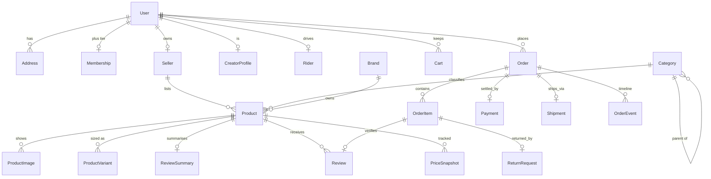
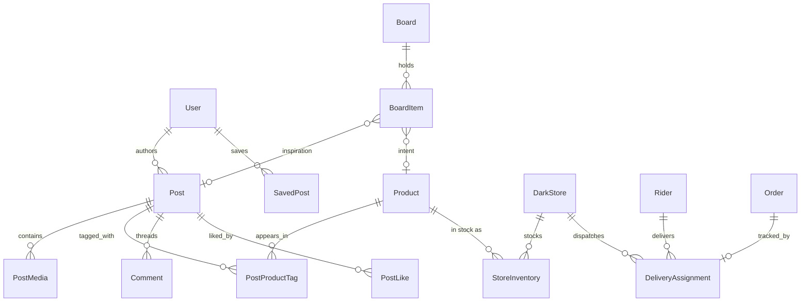

# VELORA — Phase 1: Foundation

> **See it. Save it. Have it in ten.**
> One graph where a shoppable post, a saved board and a 10-minute delivery are the same object seen from three angles.

Phase 1 delivers the architecture, the database schema, the design system and the animated landing page. It deliberately ships **no** auth, feed or checkout — those are gated behind later phases so the visual language and the data model are proven before logic lands on top.

---

## 1. The thesis

Four products are usually four companies: Instagram (attention), Pinterest (intent), Blinkit (speed), Amazon (assortment). VELORA merges them by making **every post, pin and reel a shoppable surface**, and by resolving each tap against the two fulfilment modes in one engine:

```
creator posts ─┐
user saves   ─┼─▶  product intent  ──▶  is it in the dark store ≤ 2.5 km?
search / AI  ─┘                           ├─ yes → QUICK         (10 min, live rider)
                                          └─ no  → MARKETPLACE   (2–8 days, seller)
```

That single branch is why the schema keeps `FulfillmentMode` on `Cart`, `CartItem`, `Order` **and** `DarkStore` stock: the same SKU can be both an impulse buy and a two-week shipping order.

### The loop in four beats

| Beat | Surface | What the user does | What the system records |
| --- | --- | --- | --- |
| 1. **See** | For You / Reels | Watches a creator wear a product | `FeedImpression`, `AnalyticsEvent(VIEW)` |
| 2. **Tap** | Product tag on media | Opens the shoppable sheet | `AnalyticsEvent(PRODUCT_TAP)` |
| 3. **Save** | Board | Adds to a mood board | `SavedPost` / `BoardItem` |
| 4. **Get** | Cart orb | Quick box or marketplace order | `Order(mode)` + `DeliveryAssignment` / `Shipment` |

---

## 2. Architecture

```
┌──────────────────────────────────────────────────────────────────────┐
│  apps/web — Next.js 14 App Router (RSC shell + client islands)       │
│  Tailwind ← preset ─┐                                                │
│  Framer Motion · GSAP/ScrollTrigger · Lenis · R3F · Zustand · Query  │
└─────────────┬───────────────────────────────┬────────────────────────┘
              │ server actions / fetch        │ WebSocket (phase 5)
┌─────────────▼───────────────┐   ┌───────────▼────────────────────────┐
│ apps/api — Express + Zod    │   │ workers (phase 6)                  │
│ REST /v1 · JWT · RBAC       │   │ ranking · embeddings · ETA · fraud │
└─────────────┬───────────────┘   └───────────┬────────────────────────┘
              │                               │
┌─────────────▼───────────────────────────────▼────────────────────────┐
│  packages/db — Prisma client + seed                                  │
│  PostgreSQL 16 · pgvector(1536) · pg_trgm · Redis (cache/queues)     │
└──────────────────────────────────────────────────────────────────────┘
┌──────────────────────────────────────────────────────────────────────┐
│  packages/design-system — tokens.cjs · tailwind-preset.cjs · theme.css│
└──────────────────────────────────────────────────────────────────────┘
```

**Why a monorepo of four packages:** the design tokens are consumed by both the marketing surface and (later) the admin panel, and the Prisma client is consumed by both the API and background workers. Duplicating either would let the brand and the money type drift.

**Why Express over NestJS:** Phase 1 needs an honest, typed, three-file server. Nest's DI graph buys structure we cannot use until Phase 2 and costs ~30 files of ceremony. The module layout (`config / middleware / routes / lib`) maps onto Nest's concepts 1:1 if we migrate later.

**Rendering strategy:** the landing page is a server component tree with small client islands (`'use client'` only where motion, pointer, or browser storage is required). That keeps the first paint SSR/SEO-clean and the JavaScript payload bounded.

---

## 3. Folder structure

```
velora/
├─ apps/
│  ├─ web/
│  │  ├─ public/                    manifest.webmanifest, icon.svg
│  │  └─ src/
│  │     ├─ app/                    layout.tsx (fonts, metadata, chrome), page.tsx, globals.css
│  │     ├─ components/
│  │     │  ├─ art/                 ProductArt — generative SVG pack shots (no remote assets)
│  │     │  ├─ chrome/              Header · Dock · CartOrb · Cursor · Intro
│  │     │  ├─ commerce/            ProductCard (tilt + hover CTA)
│  │     │  ├─ landing/             Hero · HeroStage · LoopSection · Discovery · Quick ·
│  │     │  │                       Marketplace · Ai · Studio · FooterCta · Atmosphere
│  │     │  ├─ providers/           SmoothScroll (Lenis ↔ GSAP ↔ ScrollTrigger)
│  │     │  ├─ three/               HeroScene (R3F cluster, lazy-mounted)
│  │     │  └─ ui/                  motion primitives · surface · button
│  │     └─ lib/                    utils (cn, money, compact) · content/landing.ts
│  └─ api/
│     └─ src/                       app.ts · main.ts · config/ · middleware/ · routes/ · lib/
├─ packages/
│  ├─ db/       prisma/schema.prisma · prisma/seed.ts · src/index.ts
│  └─ design-system/  tokens.cjs · tailwind-preset.cjs · styles/theme.css
└─ docs/PHASE-1.md
```

---

## 4. Data model

Conventions that hold across all 60 models:

- **Money is `Int` paise.** No floats, no `Decimal` round-trips, no locale drift between server and client.
- **Counters are denormalised** (`Post.likeCount`, `Product.soldCount`, `Board.itemCount`) so a feed renders without aggregates; a nightly job reconciles them against the event tables.
- **Snapshot the past.** `OrderItem` stores `title`/`unitPrice`, `Order` stores `addressSnapshot`. Editing a product or address must never rewrite history.
- **Embeddings are `Unsupported("vector(1536)")`** — Prisma reads them but cannot write them, so the AI worker inserts via `toVectorLiteral()` in `packages/db/src/index.ts`.
- **Polymorphic edges are strings** (`Report.subjectType`, `AnalyticsEvent.entityType`, `RiskSignal.subjectType`) so moderation and telemetry never cascade-delete business data.

### 4.1 Identity, catalogue, commerce



`Cart` is unique per `(userId, mode)` — a user keeps a quick box **and** a marketplace basket in parallel, which is the whole point of the dual-delivery model.

### 4.2 Social, discovery, quick commerce



`PostProductTag` carries `x`, `y` **and** `atMs` — one model serves both a still image hotspot and a timecode inside a reel.

### 4.3 Intelligence surfaces

`AnalyticsEvent` (append-only behaviour log) and `FeedImpression` train the For You ranker. `AssistantThread` / `AssistantMessage` store tool calls and retrieved product ids so answers stay debuggable and evaluable. `SmartSubstitution` is precomputed per store so a stock-out never blocks checkout. `ReorderSuggestion` and `PriceForecast` are derived rows, safe to rebuild.

### 4.4 Seed data

`pnpm db:seed` is deterministic (`mulberry32(20261110)`): **520 products** across 20 collections, 26 categories, 20 brands, 6 sellers, 6 creators, 6 shoppers, 3 riders, 5 Bengaluru dark stores, 32 shoppable posts, 6 boards, 12 orders (6 quick with live routes, 6 marketplace), 120 reviews, price history and forecasts, analytics, moderation queue and AI threads. Same numbers on every machine — screenshots and snapshots stay comparable.

---

## 5. Design system

**Direction:** *premium floating, awe-struck* — glass over midnight, one editorial display face, three accent lights, and depth that comes from blur + layered shadow rather than borders.

### Tokens (`packages/design-system/tokens.cjs`)

| Group | Values |
| --- | --- |
| Surfaces | `ink #05060C` · `inkSoft` · `inkRaised` · `inkLine` |
| Accents | `violet #7C5CFF` · `coral #FF6B6B` · `aqua #35E7D2` · `amber #FFC46E` |
| Light mode | `paper #F6F5F2` · `paperRaised` · `paperLine` |
| Radii | `4xl 2rem` · `5xl 2.75rem` · `6xl 3.5rem` · `pill 999px` |
| Motion | `fast 180ms` · `base 320ms` · `slow 640ms` · `cinematic 1200ms` · ease `[0.22,1,0.36,1]` |
| Layout | container `82rem` · nav `84px` · cart orb `64px` · fluid `gutter` / `sectionY` |
| Breakpoints | `xs 380 → 4xl 2560` |

Tokens are plain CJS so Tailwind (build time) **and** app code (runtime) read the same numbers. The Tailwind preset exposes semantic colours as `rgb(var(--vl-*) / <alpha-value>)`, which is what makes light mode a single attribute flip (`html[data-theme='light']`) rather than a `dark:` prefix on every element.

**Typography is self-hosted.** Space Grotesk and Inter ship as variable fonts through Fontsource, imported in `layout.tsx` and mapped to `--font-display` / `--font-sans` in `globals.css`. `next/font/google` was rejected because it requires network access to Google at build time — the build failed in an offline environment, and a font CDN is a needless production dependency regardless.

### Component primitives (`components/ui`)

- `Reveal`, `SplitHeading` (word-stagger, single-`h1` safe), `Magnetic`, `TiltCard` (spring rotate + glare), `AnimatedCounter`, `Marquee`.
- `GlassPanel`, `Badge`, `SectionHeading`, `Hairline`, `buttonStyles`.
- `ProductArt` — nine generative SVG pack shots (lamp, sneaker, bag, watch, bottle, chair, headphones, vase, camera) on layered radial gradients. Zero remote image requests, so the landing page cannot flash or 404.

### Motion rules

1. **One scroll authority.** Lenis drives GSAP's ticker; ScrollTrigger and Framer both read from it. Two independent RAF loops is the classic jank source.
2. **CSS sticky for pinning**, Framer `useScroll` for progress. GSAP `pin` fights Lenis on mobile Safari; `position: sticky` + `useMotionValueEvent` gives the same pinned narrative with no layout thrash.
3. **Transform + opacity only.** No animating `width`/`top`/`filter` on scroll.
4. **`prefers-reduced-motion` is a first-class branch** in every primitive (intro, cursor, 3D scene, marquee, counters), not a global CSS kill switch alone.
5. **Heavy 3D is earned.** `HeroScene` mounts only after an `IntersectionObserver` hit, is `next/dynamic ssr:false`, and caps DPR at 1.75.

---

## 6. API surface

| Method | Path | Phase | Purpose |
| --- | --- | --- | --- |
| GET | `/health` | 1 | Liveness — never touches the DB |
| GET | `/health/ready` | 1 | Readiness — probes Postgres with a 1.5 s race, lists each dependency |
| GET | `/v1/meta` | 1 | Contract discovery: version, modules, phase ledger, endpoint map |
| POST | `/v1/auth/*` | 2 | JWT + Google OAuth, refresh rotation, RBAC |
| GET | `/v1/feed`, `/v1/reels`, `/v1/stories` | 2 | Ranked shoppable surfaces |
| CRUD | `/v1/boards`, `/v1/search/visual` | 3 | Discovery + image search |
| CRUD | `/v1/cart`, `/v1/orders`, `/v1/returns` | 4 | Marketplace commerce |
| GET | `/v1/stores/nearest`, WS `/rt/tracking` | 5 | Quick commerce + live rider |
| POST | `/v1/assistant`, `/v1/studio/*` | 6 | AI assistant, creator/seller analytics |

Every response uses one of two envelopes — `{ ok: true, data }` or `{ ok: false, error: { code, message, details }, requestId }` — and every request carries `x-request-id` (echoed, reused from a proxy if present) so a support ticket maps to a log line.

---

## 7. Local setup

```bash
# 1 — install
pnpm install

# 2 — API env
cp apps/api/.env.example apps/api/.env

# 3 — database (optional for the landing page)
docker run -d --name velora-pg -p 5432:5432 \
  -e POSTGRES_USER=velora -e POSTGRES_PASSWORD=velora -e POSTGRES_DB=velora \
  pgvector/pgvector:pg16
pnpm db:push      # applies schema.prisma
pnpm db:seed      # 520 products + full demo graph

# 4 — run
pnpm dev          # web :3000 · api :4000
```

The landing page is fully static and needs **no** database. `pnpm dev:api` alone gives `/v1/meta` and `/health`; `/health/ready` returns `503 degraded` until Postgres answers, which is the correct behaviour for a readiness probe.

### Verification performed

| Check | Result |
| --- | --- |
| `prisma validate` | valid (after fixing two relation errors) |
| `prisma generate` | client v5.22.0 emitted |
| `tsc --noEmit` — `packages/db`, `apps/api`, `apps/web` | clean, strict + `noUncheckedIndexedAccess` |
| `next build` | `/` prerendered static · 16.6 kB route · 161 kB first load JS · 45 kB CSS |
| `node scripts/verify.mjs` against `next start` | 21/21 (API contract, readiness envelope, SSR content, fonts, tokens, reduced-motion) |

**Not executed here:** the seed. This environment has no PostgreSQL or Docker, so `pnpm db:push && pnpm db:seed` is the first thing to run on a machine with a database. The schema is validated, the client is generated and the seed typechecks, but row-by-row foreign-key behaviour is unproven until it runs against Postgres.

---

## 8. Phase gates

| Phase | Scope | Gate before moving on |
| --- | --- | --- |
| **1 — Foundation** ✅ | Architecture, schema, tokens, landing | Build green, tokens consumed by two surfaces |
| 2 — Social | Auth + RBAC, feed, reels, stories, profiles, DMs | Reels stay 60 fps on a mid-range Android |
| 3 — Discovery | Masonry, boards, visual search | Save → board → back to feed round-trip |
| 4 — Marketplace | PDP, variants, cart, checkout, orders, returns | Stripe/Razorpay sandbox order reaches `DELIVERED` |
| 5 — Quick commerce | Nearest store, live stock, rider tracking | ETA honest to ±2 min under simulated load |
| 6 — Intelligence | Ranking, assistant, substitution, studio, admin | Assistant answers a budget query with in-stock items only |
| 7 — Polish | Perf, a11y, animation pass, deployment | Lighthouse ≥ 90, WCAG AA audit clean |

### Decisions to revisit

- **Search** currently relies on `pg_trgm` + pgvector; if query volume outgrows Postgres, move to a dedicated engine. The schema already stores `SearchQuery` so the migration is data-driven.
- **Redis** is optional in Phase 1. Live tracking, queues and rate limiting assume it; Phase 5 must add it before WebSockets ship.
- **API build** is typecheck-only. Phase 7 adds a bundler (esbuild/tsup) so `@velora/db`'s TypeScript entry can be compiled for a non-tsx runtime.
